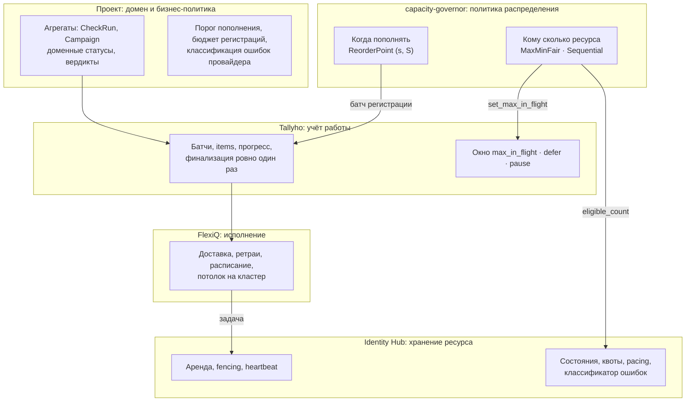
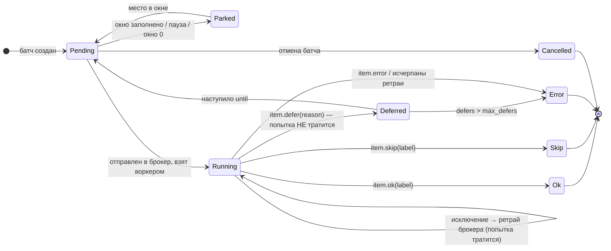
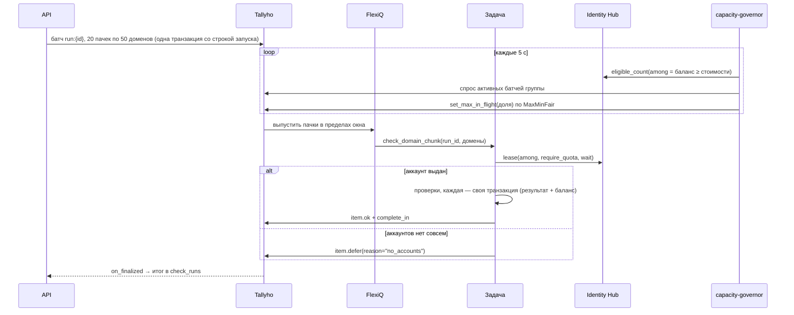
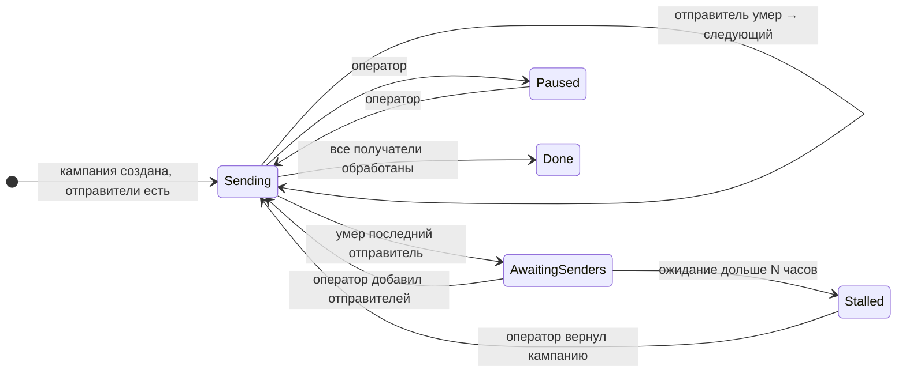

# Управление ограниченными ресурсами при массовой работе

Проектный документ по итогам обсуждения. Он фиксирует задачу, словарь, разделение
ответственности между библиотеками, механизмы и политики управления ресурсами, доработки
Tallyho и Identity Hub и устройство новой библиотеки управления ресурсами.

Рабочее название новой библиотеки в документе — **`capacity-governor`**.

---

## 1. Задача

Пользователь ставит объёмную работу: проверить 1000 доменов, разослать письма 10 000
получателям, зарегистрировать 500 аккаунтов. Выполнить её можно только через **дефицитные
ресурсы**:

* аккаунты внешних сервисов: их мало, они банятся, у них кончается баланс;
* ресурсы машины: браузеры, CPU, память;
* квоты провайдеров: N запросов в минуту на ключ, суточные лимиты.

Работы всегда больше, чем ресурсов. Значит, нельзя просто положить 1000 задач в брокер и
запустить их параллельно. Нужно:

1. выпускать в работу ровно столько, сколько можно обслужить ресурсами прямо сейчас;
2. не тратить попытки и не ломать работу, когда ресурса нет;
3. делить ресурс между потребителями справедливо или по заданной политике;
4. реагировать на изменение ёмкости во время работы: аккаунты кончаются, банятся,
   пополняются;
5. пополнять ресурс, когда его не хватает, но в пределах бюджета и с гистерезисом;
6. останавливать работу с понятным статусом, когда ресурса нет совсем, и продолжать её
   автоматически, когда он появился.

Эталонные сценарии, на которых проверялось решение:

| Сценарий | Ресурс | Особенность |
|---|---|---|
| Проверка доменов | общий пул API-аккаунтов с денежным балансом | ёмкость тает с балансом, пул делят все запуски |
| Массовая рассылка | пул отправителей у каждой кампании + общие браузеры | у кампании один активный отправитель, расход последовательный |
| Регистрация аккаунтов | почты, телефоны, прокси | это та же задача уровнем ниже: пополнение ресурса — тоже работа с ресурсами |

---

## 2. Словарь

| Термин | Значение |
|---|---|
| **Ресурс** | то, без чего единицу работы выполнить нельзя: аккаунт, браузер, кредит, слот |
| **Пул** | множество взаимозаменяемых ресурсов под одну задачу |
| **Ёмкость** | сколько ресурса пригодно прямо сейчас, включая уже занятый |
| **Потребитель** | тот, кто расходует ресурс: запуск проверки, кампания. Обычно это один батч |
| **Спрос** | сколько ресурса потребитель мог бы занять прямо сейчас: непроверенные пачки, ограниченные его потолком |
| **Окно** (`max_in_flight`) | сколько единиц работы потребителя одновременно находится в брокере и в работе |
| **Аренда** (lease) | эксклюзивное или разделяемое право пользоваться ресурсом с heartbeat и fencing |
| **Отложить** (defer) | вернуть единицу работы в учёт на потом, **не тратя попытку** |
| **Справедливая доля** | ёмкость, делённая между потребителями с учётом весов |
| **Burst** | потребитель берёт больше своей доли, пока другим она не нужна |
| **Round robin** | раздача по одному по кругу: A, B, C, A, B, C… |
| **Гистерезис** | разрыв между порогом начала действия и уровнем, до которого оно выполняется |
| **(s, S)** | политика запасов: опустились ниже *s* — дозаказываем до *S* |
| **Контур (controller)** | периодический процесс «желаемое против фактического», который приводит систему к цели |

---

## 3. Разделение ответственности

Главное правило: **механизмы — в библиотеках нижнего уровня, политика — в отдельной
библиотеке, бизнес-решения — в проекте.**



| Слой | Отвечает на вопрос | Не знает о |
|---|---|---|
| **Проект** | что значит «проверить домен», когда кампания закончена, сколько стоит регистрация | конкретных механизмах очередей |
| **capacity-governor** | кому сколько ресурса сейчас, когда пополнять | доменах, письмах, брокере |
| **Tallyho** | сколько работы сделано, сколько выпустить в брокер, что отложено | аккаунтах, балансах |
| **Identity Hub** | какой аккаунт можно взять, кто его держит, жив ли он | доменах и батчах |
| **FlexiQ** | выполнить, повторить, запустить по расписанию | всём остальном |

Почему политика не в Tallyho:

* Tallyho перестанет быть учётом работы, а это его ценность;
* ресурс бывает не только из Identity Hub: браузеры из browser-pool, прокси, слоты GPU;
* политика — чистая функция, её проще тестировать и симулировать отдельно от базы.

Почему политика не в Identity Hub: раздача ёмкости между потребителями нужна для любых
ресурсов, а не только для аккаунтов.

---

## 4. Модель ресурсов

### 4.1. Три вида ресурса

Это та же классификация, что в SimPy.

| Вид | Пример | Как ограничивать |
|---|---|---|
| **Слоты** — статичная ёмкость | 20 браузеров на машине | постоянный потолок: FlexiQ `max_concurrent`, лимит browser-pool |
| **Объекты с состоянием** — отбор по условию | аккаунты: живые, с балансом, нужного региона | аренда Identity Hub с фильтром `among=` |
| **Количество** — расходуемый запас | кредиты на балансе | учёт в таблице проекта; при необходимости резерв «оценка → факт» |

Ёмкость пула аккаунтов меряется не штуками, а **эффективными аккаунтами**:
сумма кредитов делённая на кредиты нового аккаунта. Пул из 50 аккаунтов по одному кредиту
фактически пуст.

### 4.2. Общий и выделенный пул

| | Общий пул | Выделенный пул |
|---|---|---|
| Пример | API-аккаунты проверки на все запуски | отправители конкретной кампании |
| Кто решает, сколько выдать | **capacity-governor** по политике | **агрегат потребителя** по своему статусу |
| Окно потребителя | пересчитывается контуром каждые N секунд | меняется в транзакции со сменой статуса |

### 4.3. Эксклюзивная и разделяемая аренда

* **Эксклюзивная** (по умолчанию): один держатель. Подходит для Telegram и для API-ключа,
  баланс которого пишется под арендой без гонок.
* **Разделяемая** (`LeaseMode.SHARED`): ресурс одновременно в нескольких потребителях.
  Например, один отправитель в разных кампаниях. Состояние, квоты и классификатор ошибок
  остаются общими на аккаунт.

Перед выбором SHARED нужно проверить, не сочтёт ли платформа одновременную работу одного
аккаунта из нескольких мест подозрительной.

---

## 5. Единица работы

### 5.1. Жизненный цикл item'а с `defer`

Имена состояний условные.



### 5.2. Классификация отказов

Реакция определяется тем, **кто виноват**. Это ключевое решение в каждой задаче.

| Что случилось | Чья проблема | Реакция |
|---|---|---|
| Доменный исход («домен мёртв», «адрес не существует») | не ошибка | `item.ok(label)` |
| Все ресурсы заняты (`LeaseUnavailable.reason = busy`) | временная нехватка | `lease(wait=…)`, затем `item.defer` |
| Пригодных ресурсов нет совсем (`no_candidates`) | ресурс исчерпан | `item.defer(reason="no_resources")`; контур ставит окно 0 |
| У конкретного ресурса кончился баланс (402) | конкретный ресурс | обнулить баланс, `item.defer` — следующая попытка возьмёт другой |
| Ресурс сломан (бан, неверный ключ) | конкретный ресурс | классификатор Identity Hub меняет состояние; `item.defer` |
| Квота ресурса исчерпана (`QuotaExhausted.retry_at`) | ресурс на время | `item.defer(until=retry_at)` или другой ресурс |
| Сеть, 5xx, таймаут | провайдер | исключение → ретрай брокера |
| Задачу забрали у воркера (`LeaseLostError`) | учёт работы | не ловить: транзакция откатывается, ретрая нет |
| Половина задач `exhausted` | провайдер лежит | политика ошибок Tallyho ставит батч на паузу |

Правило: **ретрай брокера — только для того, что лечится повтором той же задачи.**
Отсутствие ресурса повтором не лечится, это `defer`.

### 5.3. Атомарность итога

Всё, что задача делает от имени ресурса, записывается **одной транзакцией, пока аренда ещё
жива**:

1. доменный результат;
2. новое состояние ресурса (абсолютное значение баланса, а не декремент);
3. итог item'а (`item.complete_in(session)`).

Под эксклюзивной арендой никто другой ресурсом не пользуется, поэтому запись баланса
обходится без гонок.

### 5.4. Пачки

Если взять ресурс дорого (логин в Telegram, поднять браузер), item — это **пачка** единиц
работы, а не одна.

* Ресурс арендуется один раз на пачку.
* Каждая единица внутри пачки сохраняется сразу. При повторе пачка доделывает только остаток.
* `weight=len(chunk)` — прогресс считается в единицах, а не в пачках.
* Размер пачки ограничен сверху `timeout` задачи и `max_hold` аренды. Ожидание ресурса
  (`wait`) должно быть больше времени одной пачки.

`CHUNK` и окно — разные оси:

* `CHUNK` — сколько единиц работы делает одна задача, держа один ресурс;
* окно — сколько таких задач потребителя работает одновременно.

### 5.5. Задача-продолжение

Задача, которая держит ресурс, обрабатывает K пачек и ставит саму себя заново. Это
pull-режим без вечных задач: аренда и время задачи ограничены, остановка воркера
корректна.

---

## 6. Механизмы управления ёмкостью

От грубого к точному:

| # | Механизм | Где | Что ограничивает | Динамический? |
|---|---|---|---|---|
| 1 | Потолок на кластер | FlexiQ `max_concurrent` | одновременные задачи типа на весь кластер | нет, применяется при старте воркера |
| 2 | Лимит на машину | browser-pool, `async_concurrency` | ресурсы конкретной машины | нет |
| 3 | Окно потребителя | Tallyho `max_in_flight` | сколько работы потребителя в брокере | **да**, после доработки |
| 4 | Аренда с ожиданием | Identity Hub `lease(wait=…)` | точный выбор ресурса, эксклюзивность | да |
| 5 | Отложить | Tallyho `item.defer` | работа без ресурса ждёт, не тратя попытки | — |
| 6 | Контур ёмкости | capacity-governor | пересчитывает окна по ёмкости | да |
| 7 | Контур пополнения | capacity-governor | дозаказывает ресурс | да |

Принцип: **ожидание ресурса должно происходить до отправки в брокер, а не внутри задачи.**
Окно (3) держит в брокере не больше работы, чем есть ресурса. Аренда с ожиданием (4)
сглаживает несколько секунд между тактами контура. `defer` (5) — страховка на редкие промахи.

Статичный ресурс (железо) ограничивается статичным потолком (1, 2), контур ему не нужен.
Контур нужен ресурсу, ёмкость которого меняется.

---

## 7. Политики распределения

### 7.1. `MaxMinFair` — общий пул, справедливо

Раздача по одному по кругу. Получивший сколько нужно выбывает, остаток достаётся
остальным. Это одновременно справедливая доля, burst и round robin.

Параметры потребителя (термины из YuniKorn и Kueue):

| Параметр | Смысл |
|---|---|
| `weight` | в каждом круге потребитель получает `weight` единиц (премиум = 2) |
| `guaranteed` | минимум, который выдаётся первым, если ёмкость позволяет |
| `max` | жёсткий потолок потребителя, даже если ёмкость свободна |
| `demand` | сколько потребитель может занять прямо сейчас |

Порядок обхода сдвигается каждый такт. Когда ресурса меньше, чем потребителей, единица
переходит по кругу между тактами и никто не голодает вечно.

| Ёмкость | Спрос A / B / C | Выдача A / B / C |
|---|---|---|
| 30 | 1000 / 5 / — | 25 / 5 / — |
| 30 | много / много / много | 10 / 10 / 10 |
| 6 | много / много / много | 2 / 2 / 2 |
| 2 | много / много / много | 1 / 1 / 0, затем 0 / 1 / 1 |
| 0 | много / много / много | 0 / 0 / 0 |

Уменьшение окна не прерывает выполняющуюся работу: новая просто не выходит, пока окно не
освободится. Принудительное вытеснение — через приоритет и кооперативную уступку аренды
Identity Hub, не через окно.

### 7.2. `Sequential` — выделенный пул, последовательный расход

Потребитель держится за текущий ресурс, пока тот жив, и только потом переходит к
следующему. Окно — 1, если живой ресурс есть, иначе 0.

Текущий ресурс — **доменное состояние потребителя** (например, `Campaign.current_sender_id`),
а аренда идёт строго по нему: `among=[current]`. Иначе Identity Hub выдаст давно не
использованный ресурс и начнёт их чередовать.

Переключение выполняется под блокировкой строки потребителя, со сравнением «текущий ==
умерший». Тогда несколько задач, одновременно увидевших смерть ресурса, не перескочат через
несколько ресурсов.

### 7.3. `StaticCeiling` — без контура

Для статичных ресурсов: потолок задаётся настройкой брокера или пула. Если окно 1 у каждого
потребителя и есть общий потолок, получается неявный round robin: у каждого потребителя в
очереди не больше одной задачи.

---

## 8. Пополнение ресурса

### 8.1. Три правила

1. **Планка (s, S).** Эффективных ресурсов меньше `reorder_ratio × target` → дозаказать до
   `target`. Выше порога — ничего.
2. **Нехватка под спрос.** Ресурса не хватает на уже поставленную работу → заказать ровно
   нехватку, даже если планка не пробита. Это правило закрывает холодный старт (0 аккаунтов,
   100 доменов) и наплыв (обычно 1000 в день, пришло 10 000).
3. **Бюджет.** Не больше N заказов в час или сутки, что бы ни требовали первые два правила.

В расчёт обязательно входят **заказы в работе**. Без них контур на каждом такте заказывает
повторно, пока идут предыдущие.

### 8.2. Примеры (target 50, порог 20 %, бюджет 20/ч, 100 кредитов на аккаунт)

| Ситуация | Эффективных | Нужно кредитов | Решение |
|---|---|---|---|
| Холодный старт, 100 доменов | 0 | 100 | 50 по планке → 20 по бюджету |
| Обычный день | 35 | 1 000 | 0 |
| Запас упал | 8 | 500 | 42 → 20 по бюджету |
| Наплыв 10 000 доменов | 30 | 10 000 | 70 → 20 сейчас, остальное в следующие часы |
| Регистрация уже идёт (20) | 8 + 20 | 500 | 0 |

### 8.3. Пополнение — тоже работа с ресурсами

Заказ — это батч Tallyho (`key` по минуте, `opts(key=slot:i)`, небольшое окно). Каждая
регистрация арендует свои ресурсы: почту, телефон, прокси. Это вложенный уровень той же
схемы, его реализует библиотека авторизации и регистрации.

* Неудачная регистрация — `item.error`. Контур увидит, что заказов в работе стало меньше, и
  закажет снова в пределах бюджета.
* Успешная — ресурс сразу пригоден. Контур распределения на следующем такте увеличит окна.

### 8.4. Ручное пополнение

Для выделенных пулов, где ресурс добавляет оператор:

* нет ресурсов → статус потребителя «ждёт ресурсов», окно 0, уведомление оператору;
* оператор добавил ресурсы → статус «работает», окно 1;
* ожидание дольше N часов → статус «остановлен»: потребитель не отменён, оператор может
  вернуть его позже.

---

## 9. Сценарии

### 9.1. Проверка доменов



* Ресурс: общий пул API-ключей, баланс в таблице проекта, отбор через `among=`.
* Политика: `MaxMinFair` по всем запускам + `ReorderPoint` для регистрации ключей.
* Окно: динамическое, от ёмкости.

### 9.2. Массовая рассылка



| Статус кампании | Окно батча |
|---|---|
| Sending | 1 |
| AwaitingSenders | 0 |
| Paused | 0 |
| Stalled | 0 |
| Done | — |

* Получатели и отправители известны при создании кампании: батч создаётся один раз.
* Окно выводится из статуса **в той же транзакции**, что и смена статуса. Единственный
  источник правды — статус, поэтому ручная пауза и автоматическая не конфликтуют.
* Отправитель может работать в нескольких кампаниях одновременно, поэтому аренда разделяемая
  (`SHARED`).
* Железо (~20 браузеров): статичный потолок — FlexiQ `max_concurrent=20` на задаче отправки
  и лимит browser-pool на машине. Окно 1 на кампанию + общий потолок = неявный round robin.
* Отправка неидемпотентна: каждое письмо — `lease.operation("send", key=send:{campaign}:{recipient})`.
  При неизвестном исходе прошлой попытки — сверка с провайдером, а не повтор.
* Политика: `Sequential`, решение принимает агрегат кампании, контур распределения не нужен.

---

## 10. Доработки Tallyho

Tallyho остаётся независимым от ресурсов. Он даёт **механизмы**: отложить, менять окно,
дёшево читать спрос.

### 10.1. `item.defer` — отложить без траты попытки

```python
item.defer(*, reason: str, delay: timedelta | None = None, until: datetime | None = None) -> None
```

Семантика:

* Это итог попытки, как `ok/skip/error`, и записывается он так же: после возврата из задачи
  или через `item.complete_in(session)` атомарно с доменными записями. Например, «обнулить
  баланс + отложить» — одним коммитом.
* Брокер получает успех: попытка брокера **не тратится**, ретрая и DLQ нет.
* Item возвращается в учёт с `available_at = now + delay` или `until`. Место в окне
  освобождается сразу.
* Отдельный счётчик `defers`. Ограничения задаются на батч: `max_defers` (по образцу
  reschedule-потолка Sidekiq) и/или `max_deferred_for: timedelta`. После них — итог
  `error("deferred_too_long")`.
* Батч, у которого вся оставшаяся работа отложена, **не финализируется**: остаётся `SEALED`.
  Схема «`error` + `retry_failed`» финализировала бы его, и статус потребителя «мигал» бы.
* `view().progress.deferred` и разбивка по причинам (`deferred_reasons`) — чтобы было видно
  «ждут ресурса: 340».
* `on_progress` видит отложенные. Отдельный хук на `defer` не нужен.
* Отложенный item подчиняется паузе, отмене и окну так же, как остальные.

### 10.2. Окно меняется на ходу, и ноль разрешён

```python
await handle.set_max_in_flight(limit: int, *, session=None) -> None   # limit >= 0
```

* `max_in_flight` уже колонка батча, и relay читает её на каждом проходе. Метод — это
  обновление колонки и пинок relay.
* **0 разрешён** и означает «ресурса нет». Это не пауза: флаг паузы остаётся за человеком и
  политикой ошибок, и одно другое не снимает.
* При уменьшении выполняющаяся работа доделывается, новая паркуется. При увеличении relay
  возвращает запаркованную на ближайшем проходе.
* Батч без `max_in_flight` при создании окна не имеет. Для потребителей ресурса окно
  задаётся всегда; можно начать с 0, если ёмкость ещё неизвестна.

### 10.3. Дешёвое чтение спроса

```python
await th.demand(kinds: Sequence[str], *, attributes: Mapping[str, object] | None = None)
    -> list[BatchDemand]
```

`BatchDemand`: `id`, `kind`, `key`, `attributes`, `pending`, `in_flight`, `deferred`,
`max_in_flight`, `paused`. Одним запросом по всем активным батчам. Сейчас `list_batches`
счётчиков не отдаёт, а `view()` на каждый батч каждые 5 секунд — дорого.

### 10.4. Ленивый импорт `hook_modules`

Сейчас модули хуков импортируются в `Tallyho.__init__`. Схема из `docs/guide/hooks.md`
(модуль хуков импортирует `th` из модуля клиента) падает с circular import, если первым
импортирован модуль клиента. Проверено. Импортировать их нужно лениво — в `install()` или
при первом обращении к реестру хуков.

### 10.5. Потом: метки требований к ресурсу

Непрозрачная метка в опциях item'а: `th.call(...).opts(requires={"region": "DE"})`. Tallyho
её только хранит и отдаёт в `demand()`, а политика распределения раскладывает спрос по
подпулам. Нужно, когда работа требует ресурс с конкретными свойствами. Не блокирует
остальное.

---

## 11. Доработки Identity Hub

| # | Что | Зачем |
|---|---|---|
| 1 | `pool.eligible_count(among=…)` — пригодные, **включая занятые** | честная ёмкость для распределения. `capacity_detail()` считает только свободные, и тогда собственная работа уменьшает долю |
| 2 | Событие изменения ёмкости пула (бан, cooldown, карантин, новый аккаунт, рост и падение) | повод пересчитать окна сразу, а не ждать такта. `pool.capacity.low` уже есть, нужно ещё событие о росте |
| 3 | Адаптивный лимит на провайдера (AIMD: +1 за успех, ×½ при 429 / flood-wait) | для источников без документированных лимитов: Telegram, сайты |
| 4 | Резерв количества «оценка → факт» (по образцу лимитера points в Sidekiq) | для провайдеров с переменной ценой запроса |

Пункты 3 и 4 — потом.

Уже есть и используется в решении: эксклюзивная и разделяемая аренда, `wait`,
`require_quota`, `among=` подзапросом к таблице проекта, `LeaseUnavailable.reason`,
идемпотентные операции `lease.operation(key=…)`, классификатор ошибок, pacing, throttle,
уведомления.

---

## 12. capacity-governor

### 12.1. Назначение

Политика распределения ёмкости между потребителями и политика пополнения. Никакого
хранения ресурсов (это Identity Hub) и никакого учёта работы (это Tallyho).

### 12.2. Порты

```python
from collections.abc import Mapping, Sequence
from dataclasses import dataclass
from typing import Protocol


@dataclass(frozen=True, slots=True)
class ConsumerState:
    consumer_id: str
    demand: int            # сколько мог бы занять сейчас
    weight: int = 1
    guaranteed: int = 0
    max: int | None = None


class CapacitySource(Protocol):
    async def capacity(self) -> int: ...


class ConsumerSet(Protocol):
    async def consumers(self) -> Sequence[ConsumerState]: ...
    async def apply(self, limits: Mapping[str, int]) -> None: ...


class AllocationPolicy(Protocol):
    def allocate(self, capacity: int, consumers: Sequence[ConsumerState], tick: int) -> dict[str, int]: ...


@dataclass(frozen=True, slots=True)
class SupplySnapshot:
    effective_available: float   # эффективные единицы ресурса (например, кредиты / кредиты нового аккаунта)
    needed_for_demand: float     # сколько единиц нужно под уже поставленную работу
    ordered_in_progress: int
    ordered_in_window: int       # заказано за окно бюджета


class SupplySource(Protocol):
    async def snapshot(self) -> SupplySnapshot: ...


class ReplenishPolicy(Protocol):
    def to_order(self, supply: SupplySnapshot) -> int: ...


class Replenisher(Protocol):
    async def order(self, count: int, *, idempotency_key: str) -> None: ...
```

### 12.3. Политики

| Политика | Назначение |
|---|---|
| `MaxMinFair(rotate=True)` | общий пул: веса, гарантированный минимум, потолок, burst, round robin между тактами |
| `Sequential` | выделенный пул: 1, если есть живой ресурс, иначе 0. Обычно применяется агрегатом потребителя, но доступна и контуру |
| `ReorderPoint(target, reorder_ratio, max_per_window, window)` | (s, S) + нехватка под спрос + бюджет |

Все политики — чистые функции: никакой базы и никакого времени внутри. Время и номер такта
передаются снаружи.

### 12.4. Контур

```python
Governor(
    name="checker_accounts",
    capacity=PoolCapacity(checker_pool, among=usable_accounts_query),   # extra [identity-hub]
    consumers=BatchConsumers(th, kinds=["domain_check_run"],            # extra [tallyho]
                             weight_of=lambda batch: batch.attributes.get("weight", 1)),
    allocation=MaxMinFair(),
    supply=CheckerSupply(...),                                          # проект
    replenish=ReorderPoint(target=50, reorder_ratio=0.2, max_per_window=20,
                           window=timedelta(hours=1)),
    replenisher=RegistrationBatches(th, kind="checker_account_registration"),
    every=timedelta(seconds=5),
)
```

* Такт работает в одном процессе: лидер выбирается advisory lock в Postgres, по образцу
  maintenance Tallyho.
* `governor.kick()` — пересчитать сейчас. Вызывается по событиям Identity Hub и проекта: у
  ресурса кончился баланс, добавлен ресурс, создан или завершён потребитель.
* `apply` идемпотентен: выставляет абсолютные окна, а повтор такта ничего не ломает.
* Заказ пополнения идемпотентен по ключу окна времени.
* Наблюдаемость: на каждом такте ёмкость, спрос, выдача по потребителям и заказ. Это и есть
  график загрузки пула для админки.

### 12.5. Адаптеры — опциональные extras

| Extra | Что даёт |
|---|---|
| `[identity-hub]` | `PoolCapacity` поверх `eligible_count`; подписка на события ёмкости → `kick()` |
| `[tallyho]` | `BatchConsumers` поверх `th.demand()` и `set_max_in_flight`; `RegistrationBatches` для заказов |
| `[browser-pool]` | ёмкость пула браузеров, если её тоже нужно делить политикой, а не статичным потолком |

Ядро от них не зависит, как ядро Tallyho не зависит от FlexiQ.

### 12.6. Тестирование

* Политики покрываются табличными тестами (таблицы из разделов 7 и 8).
* Симуляция на SimPy. Аккаунты моделируются как `FilterStore`, кредиты как `Container`,
  браузеры как `Resource`. Сутки с наплывом прогоняются до продакшена, по ним подбираются
  порог, цель и бюджет. Политики подключаются к симуляции как есть, потому что они чистые.

---

## 13. Найденные проблемы и ограничения

| Где | Что | Статус |
|---|---|---|
| Tallyho | circular import в документированной схеме `hook_modules` | обойдено явным импортом; исправление — 10.4 |
| Tallyho | нет «отложить без попытки» | 10.1 |
| Tallyho | окно статично, ноль запрещён | 10.2 |
| FlexiQ | overrides `max_concurrent` применяются только при старте воркера | годится только как статичный потолок |
| FlexiQ + Tallyho | `@task(batch=...)` FlexiQ несовместим с Tallyho | пачки нарезаются при постановке |
| Identity Hub | `capacity_detail()` не считает занятые | 11.1 |
| Identity Hub | типизация `IdentityCreate(service=Service[...])` не принимает конкретный сервис из-за инвариантности дженерика | пока `service=SERVICE.name` |

Сквозной прогон domain-checker (без доработок): 20 доменов, кредитов 5 + 3 + 0.

* После 8 проверок запуск ушёл в ожидание аккаунтов, после пополнения продолжил работу и
  закончился на 20 из 20.
* Ровно 20 платных вызовов, балансы совпали с провайдером, параллельных запросов с одного
  ключа — максимум 1.
* Сгорело 10 ретраев на 12 ждавших доменов. Это и есть пробел 10.1.

---

## 14. Открытые решения

1. **Исчерпанный суточный лимит отправителя** — переключаться на следующего (быстрее, но
   пул тратится) или ждать сброса (экономно, но кампания растягивается)? Предложение:
   настройка кампании.
2. **Одновременная работа одного отправителя в нескольких кампаниях** — допустима ли для
   почтового провайдера? От этого зависит, SHARED аренда или EXCLUSIVE.
3. **Время ожидания оператора** до статуса «остановлен» и что потом: остановка, отмена,
   уведомление повторно.
4. **Дедлайн батча и паузы** — должен ли `deadline` учитывать время в окне 0? Скорее нет:
   нехватка ресурса не должна проваливать работу по времени. Нужен дедлайн «по активному
   времени» или дедлайн на стороне домена.
5. **Источник весов** — в атрибутах батча (неизменяемы) или в таблице потребителя
   (изменяемы)? Для смены тарифа на ходу нужна таблица.
6. **Цель пополнения от дедлайна**: нужно = остаток ÷ (пропускная способность ресурса ×
   время до дедлайна). Это заменяет «текущий спрос», когда у работы есть срок.
7. **Кэш результатов между запусками** — не платить второй раз за проверенное недавно. Это
   забота домена: фильтр при постановке плюс версия логики в ключе результата.

---

## 15. Порядок работ

| # | Что | Где | Даёт |
|---|---|---|---|
| 1 | `item.defer` + `max_defers` / `max_deferred_for` | Tallyho | попытки не горят, батч не мигает |
| 2 | `set_max_in_flight` с нулём | Tallyho | динамическое окно без конфликта с паузой |
| 3 | ленивый `hook_modules` | Tallyho | исправление бага из документации |
| 4 | `th.demand()` | Tallyho | дешёвый спрос для контура |
| 5 | `eligible_count` | Identity Hub | честная ёмкость |
| 6 | `capacity-governor`: ядро, `MaxMinFair`, `Sequential`, `ReorderPoint`, контур | новая библиотека | распределение и пополнение без кода в проектах |
| 7 | адаптеры `[tallyho]`, `[identity-hub]` | capacity-governor | подключение одной конфигурацией |
| 8 | события ёмкости → `kick()` | Identity Hub + адаптер | реакция за секунды |
| 9 | симуляция на SimPy | capacity-governor (dev) | подбор параметров до продакшена |
| 10 | AIMD, резерв количества, метки требований | Identity Hub / Tallyho | по мере появления провайдеров, которым это нужно |

После пунктов 1–5 domain-checker и рассылка работают без потерь попыток и без магических
констант, с распределителем в коде проекта. Пункты 6–8 переносят распределитель в
библиотеку.

---

## 16. Ссылки

Изученные решения и откуда взяты идеи.

| Источник | Что взято |
|---|---|
| [Sidekiq Enterprise — Rate Limiting](https://github.com/mperham/sidekiq/wiki/Ent-Rate-Limiting) | перепланирование вместо ретрая с отдельным потолком; лимитер points |
| [Oban Pro — Smart Engine](https://getoban.pro/docs/pro/Oban.Pro.Engines.Smart.html) | snooze без траты попытки; лимиты по партициям; burst |
| [Hatchet — Concurrency](https://docs.hatchet.run/home/concurrency) | ключи параллельности, round robin между группами, многоуровневые и вычисляемые лимиты |
| [Hatchet — Batch tasks](https://docs.hatchet.run/v1/batch-tasks) | пачки как способ дёшево расходовать дорогой ресурс |
| [Solid Queue](https://github.com/rails/solid_queue) | семафор при постановке; задача ждёт до отправки |
| [Airflow — Pools](https://airflow.apache.org/docs/apache-airflow/3.1.3/administration-and-deployment/pools.html) | слоты, вес задачи в слотах, приоритет при освобождении |
| [Prefect — Global concurrency limits](https://docs.prefect.io/v3/concepts/global-concurrency-limits) | слоты с арендой и продлением, строгий режим |
| [Temporal — Worker performance](https://docs.temporal.io/develop/worker-performance/) | своя логика выдачи слотов воркеру: воркер не берёт работу без ресурса |
| [Kueue — Fair Sharing](https://kueue.sigs.k8s.io/docs/concepts/fair_sharing/) | очерёдность по историческому потреблению, заимствование квоты |
| [YuniKorn — Queue config](https://yunikorn.apache.org/docs/user_guide/queue_config) | guaranteed / max / fair share |
| [Netflix — Performance Under Load](https://netflixtechblog.medium.com/performance-under-load-3e6fa9a60581) | адаптивный лимит параллельности по задержке |
| [SimPy — shared resources](https://simpy.readthedocs.io/en/4.1.2/api_reference/simpy.resources.html) | словарь видов ресурса; симуляция политик |
| [batchledger](https://github.com/Malanaa/batchledger) | переиспользование результатов между запусками, версия в ключе |
| [Apache DolphinScheduler #10996](https://github.com/apache/dolphinscheduler/issues/10996) | подтверждение: упаковка и рюкзак не окупаются, хватает жадной раздачи с обратной связью |
| [Serverless forum — batch job queue design](https://forum.serverless.com/t/batch-processing-job-queue-design-and-dispatch/2252) | цепочка задач-продолжений как pull-режим |

Проверенные и отклонённые как зависимости: pyrate-limiter (только частота, Postgres только
синхронно), dislock (мьютекс, не семафор), Throttle (статичные семафоры, отдельный
сервис), pulq (только в памяти, alpha), Ray (ёмкость узла нельзя менять на ходу), Dask
(свой планировщик), task-dispatcher (Celery 2018, GPLv3), pyschedule (офлайн-MIP для малых
задач).
